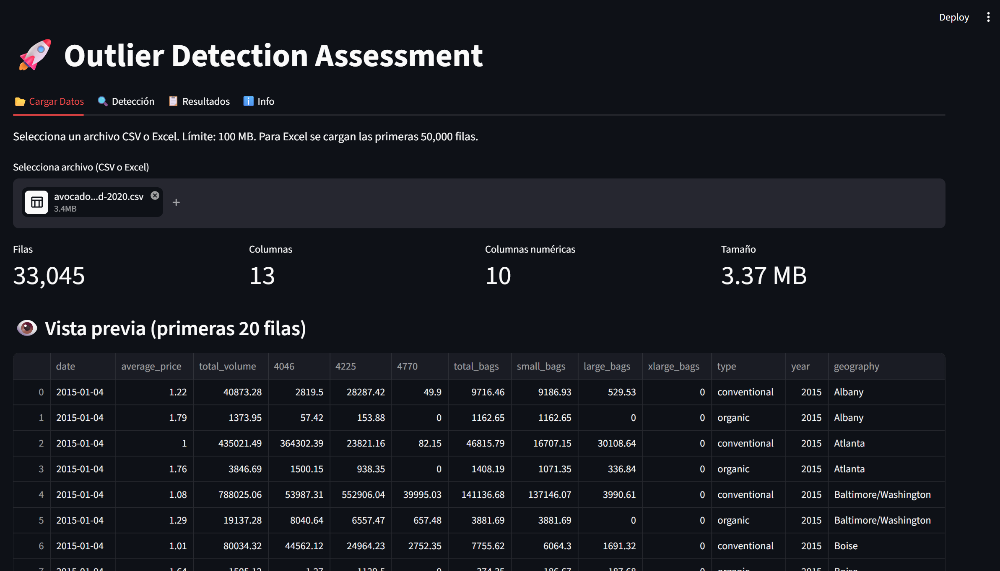
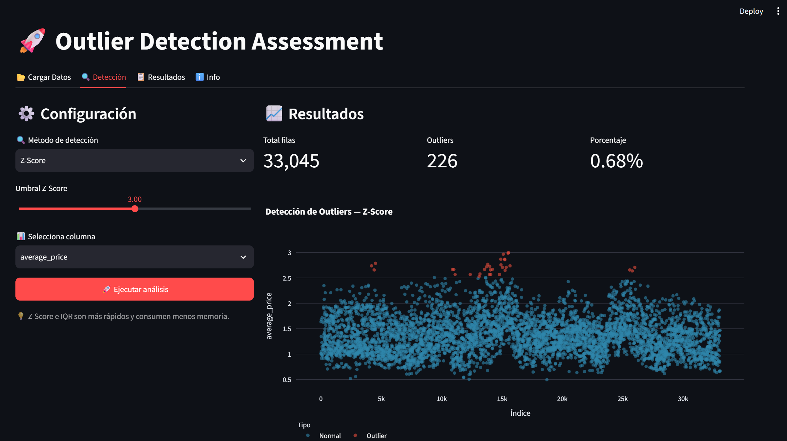
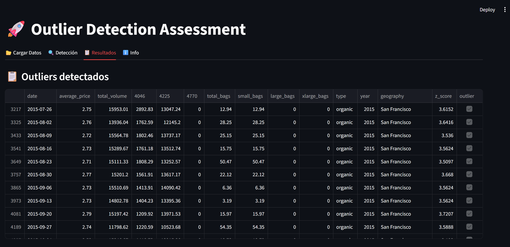

# 🚀 Outlier Detection Studio

> An interactive web app for detecting outliers in tabular data using three
> statistical and machine-learning methods — **Z-Score**, **IQR**, and
> **Isolation Forest** — built with Streamlit.


---

## 📌 Overview

**Outlier Detection Studio** is a self-service tool that lets analysts upload a
CSV or Excel file, choose a detection method, tune its parameters, and
immediately see which rows are anomalous — with interactive charts, summary
metrics, and one-click CSV export of results.

It was originally prototyped as an R Shiny app and re-implemented in Python to
exercise the full analytics stack: **pandas** for data handling,
**scikit-learn** for unsupervised ML, **Plotly** for interactive charts, and
**Streamlit** for the UI.

---

## ✨ Features

- 📂 **Flexible ingestion** — CSV (auto-delimiter detection) and Excel (multi-sheet picker), capped at 100 MB / 50,000 Excel rows.
- 📊 **Three detection methods**
  - **Z-Score** — classic univariate test with adjustable threshold (1.0–5.0 σ).
  - **IQR** — Tukey's fences with adjustable multiplier (1.0–5.0).
  - **Isolation Forest** — multivariate anomaly detection with adjustable contamination and multi-column selection.
- ⚡ **Performance-aware**
  - Cached file reads so re-runs are instant.
  - Isolation Forest trains on a 20,000-row sample for large datasets (all rows are still scored).
  - Charts sample down to 5,000 points to stay responsive.
- 📈 **Interactive Plotly scatter** with outliers highlighted in red.
- 📉 **Summary metrics** — total rows, outlier count, percentage.
- 💾 **CSV export** — full results *and* outliers-only download.
- 🧭 **Session state** — results persist across tab switches; cleared when a new file is uploaded.

---

## 🖼️ Screenshots

> *(Add 1–3 screenshots or a short GIF here. Suggested: Upload tab with metrics, Detection tab with the scatter plot, Results table.)*


| Upload | Detection | Results |
|--------|-----------|---------|
|  |  |  |

---

### Detection methods at a glance

| Method | Type | Input | Key parameter | Best for |
|--------|------|-------|---------------|----------|
| **Z-Score** | Statistical | 1 numeric column | Threshold (σ) | Roughly normal distributions |
| **IQR** | Statistical | 1 numeric column | Multiplier (× IQR) | Skewed distributions, robust baseline |
| **Isolation Forest** | Machine learning | ≥ 2 numeric columns | Contamination (%) | Multivariate anomalies |

---

## 🚀 Getting Started

### Prerequisites

- Python **3.10+**
- pip or conda

### Installation

```bash
# 1. Clone the repo
git clone https://github.com/<your-username>/outlier-detection-studio.git
cd outlier-detection-studio

# 2. Create and activate a virtual environment
python -m venv .venv
source .venv/bin/activate         # macOS / Linux
# .venv\Scripts\activate          # Windows

# 3. Install dependencies
pip install -r requirements.txt
```

### Run the app

```bash
streamlit run app.py
```

Then open **http://localhost:8501** in your browser.

---

## 📖 Usage

1. **Upload tab** → drop a CSV or Excel file (≤ 100 MB). Preview the first 20 rows and check the auto-detected numeric columns.
2. **Detection tab** →
   - Pick a method: `Z-Score`, `IQR`, or `Isolation Forest`.
   - Tune the parameter with the slider.
   - For Isolation Forest, select **≥ 2 numeric columns**.
   - Click **🚀 Ejecutar análisis**.
3. Review the **metrics** and **interactive scatter plot**.
4. **Download** the full results or just the outliers as CSV.
5. **Results tab** → inspect the outliers table.

---

## 🧠 Design Decisions

- **Why 3 methods instead of 1?** Z-Score and IQR are fast univariate baselines; Isolation Forest covers multivariate cases. Letting the user compare builds trust in the result.

---

## 📁 Project Structure

```
outlier-detection-studio/
├── .streamlit/
│   └── config.toml            # Server config (max upload size, theme)
├── docs/
│   ├── Detection.png          # Screenshot of the detection tab
│   ├── Results.png            # Screenshot of the results table
│   └── Upload.png             # Screenshot of the upload tab
├── .gitignore                 # Git exclusions (venv, __pycache__, etc.)
├── app.py                     # Main Streamlit application
├── README.md                  # Project documentation
└── requirements.txt           # Python dependencies
```

---

## 📦 Requirements

```
streamlit>=1.30
pandas>=2.0
plotly>=5.18
scikit-learn>=1.3
openpyxl>=3.1       # Excel (.xlsx) support
xlrd>=2.0           # Excel (.xls) support
```

---

## 📄 License

Released under the **MIT License** — see [LICENSE](LICENSE) for details.

---

## 👤 Author

**Ar Sullivan Santana Najera**
- 🔗 [LinkedIn](https://www.linkedin.com/in/ar-sullivan-santana-najera-758a14ab/)
- 🐙 [GitHub](https://github.com/sullivansantana)
- 📫 <sullivan.santana@gmail.com>